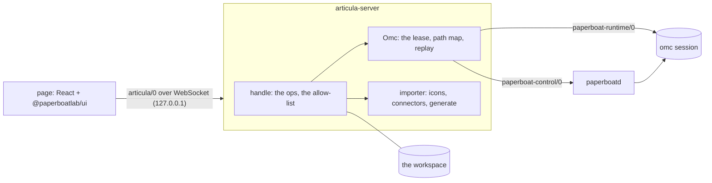

# Architecture

The plan and its decisions: `plans/2026-11-25_03-40_articula_v0_1.md` in the workspace. This page is
the map.

## 1. Overview

Articula is an app server (C++20) and a page. The server owns the workspace and speaks two protocols
of the platform: `paperboat-control/0` to `paperboatd` for omc's session lease, and
`paperboat-runtime/0` to the `omc` runtime the lease starts (`eval` = one omc expression; the
runtime's `serve.pl` bridges it to omc's own ZeroMQ server inside the container, which keeps
`--network=none`). The page is a client of the server only, over `articula/0` (JSON over WebSocket).

## 2. Codemap

- `server/src/omc.cpp`, `include/articula/omc.hpp`: `Omc`: one session lease (`acquire` on its own
  control connection, which the lease lives as long as), `eval` per call with a timeout, a new session
  after a timeout or a gone runtime (replaying `loadModel`/`loadFile`), `cancel()` (ends the session from
  another thread). Host paths are mapped to the lease's mounts in every expression (`/work/project` the
  workspace, `/work/out` the work folder omc `cd`s to, `/work/deps` its `HOME` and the libraries) and
  back in every answer; natively the map is empty. `script()` runs a `.mos` in a short exec lease (with
  the network for library downloads). Also the allow-list (`allowed`) and omc's value parser.
- `server/src/server.cpp`, `include/articula/server.hpp`: the HTTP/WebSocket server (ixwebsocket) and
  every `articula/0` op (open, workspace, class files, save, check, icon, set_icon, simulate, cancel,
  packages, generate/export, and the hubs: `hubs` from `paperboat hub list --json`, `hub_files`, `hub_new`,
  `open_window` for a model outside the workspace, through `paperboat app open`); `workspace_of` picks the lease's project (a folder, or the folder holding
  a file's top package).
- `server/src/icon.cpp`, `connectors.cpp`, `seticon.cpp`: the importer (`Icon(graphics)` → the kit's
  `IconDef`, connectors and their domains; and `icon_art`, the same graphics kept whole, which the `icon`
  op returns as `art`) and its inverse; `generate.cpp`: the station generator
  (targets the legacy engine until Simplicial is rebuilt).
- `server/src/main.cpp`: the `articula-server` binary: the server, and `check`, `generate`, `icon`.
- `src/App.tsx`: the window (REBRAND: the kit's `.win > .bar`, the frame (the bar, Files/Library and Simulate one surface, the stage and the console in the kit's `.bay`), the kit's `EditorTabs` for the
  open models and `RuntimesKey` for omc, the Panels key, Ctrl K, menus from the command registry);
  `src/shell/`: the cards and dialogs (`Rail` Files/Library, `StudioConsole`, `Opening` the kit's Splash,
  `menus.ts`).
- `src/store/`: `useStudioStore`, the `StudioApi` the views share (omc is the only source of truth: an
  edit is omc calls, then the model is read again); `src/omc/omc.ts` the `articula/0` client.
- `src/canvas/` the diagram (the kit's canvas and its `CanvasTools`), `src/icon/` the icon editor and `art.tsx`
  (a library class's `art` drawn whole and restyled by rule, in the kit plate's place), `src/library/` the
  library browser, `src/split/` the flat model and the generated C++, `src/simulate/` setup, plot and the
  variables browser, `src/viewport3d/` MultiBody shapes, `src/sheet/`, `src/popover/`, `src/dock/`.

## 3. Invariants

- omc starts only through `paperboatd`: no process, container or cleaner of Articula's own.
- omc sees only the workspace (writable: it saves `.mo` files), its work folder and the package volume.
- An expression from the page passes `allowed()` (one allow-listed call; no `system`, no `runScript`).
- The page never talks to omc or the daemon itself.
- A library icon is drawn from its own annotation (`art`), restyled by rule, never redrawn by hand; the
  token `IconDef` sizes the plate, places the ports, and is what the icon editor edits.
- Hubs are Malachite's: Articula reads them only through `paperboat hub list --json`; no Malachite, no hubs.
